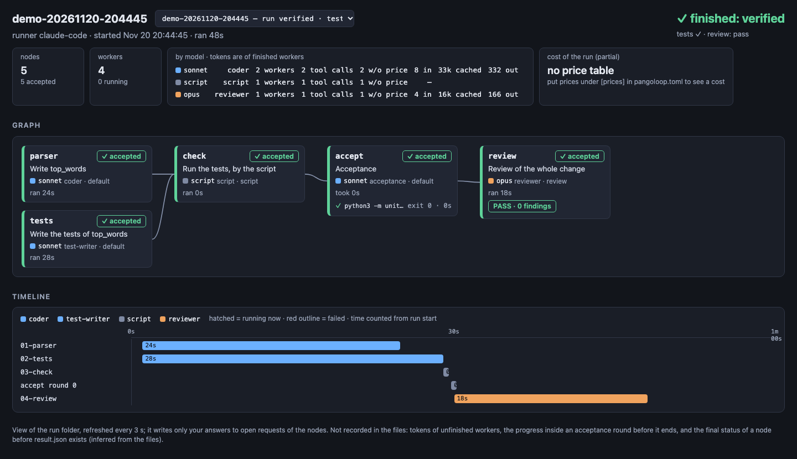

# Pangoloop

Pangoloop runs a plan of coding-agent nodes as a graph. A script, with no model in it, starts each node in its own git worktree
once the nodes it depends on are done, runs the acceptance commands, hands the whole change to an independent reviewer, and lets a
node stop and ask when it is blocked; the answers become rulings that every later node reads. A small local web page shows the run
live, and your own coding agent can drive all of it for you with the skill that comes with the package.



## With your agent

The quickest way is to let the coding agent you already use do the work. It needs Python 3.11 or newer and `git`; the package has
no other dependency.

1. **Install the package** (it is the command the skill drives):

   ```
   pipx install "git+https://github.com/albedoweb/pangoloop.git"
   ```

   or, in a virtual environment: `python3 -m venv .venv && .venv/bin/pip install "git+https://github.com/albedoweb/pangoloop.git"`.
   `pangoloop version` should answer. No tag exists yet; once one does, `@<tag>` pins it.

2. **Add the skill** (a folder, `skills/pangoloop/`, in the Agent Skills form: a `SKILL.md` and five short reference pages):
   - *Claude Code, as a plugin*: the repository is also a marketplace. `claude plugin marketplace add albedoweb/pangoloop`, then
     `claude plugin install pangoloop@pangoloop`.
   - *Claude Code, in one project*: copy `skills/pangoloop/` into that project's `.claude/skills/`.
   - *Hermes*: Hermes's own documentation says a skill is a folder with a `SKILL.md`, found under `~/.hermes/skills/`, or under a
     repository's `.hermes/skills/` or `.agents/skills/` once you have run `hermes skills trust` in that repository. Not tried with
     this skill yet.

3. **Say what you want**, in the repository you want it done in:

   > Use the pangoloop skill. Add rate limiting to the API client, with tests.

4. **Answer its questions and read its plan.** The first time in a project the agent asks, in one message, which runner you use
   (Claude Code or Hermes) and which model plays which role: the coder (most nodes), the reviewer (another model than the coder's, so
   that it does not approve what it would have written itself), the interface model if the work has a screen, and, if you like,
   readers that check the plan before the run; and whether to cap spending. It reads your code, writes a plan into
   `.pangoloop/plans/`, has it checked, and shows you a summary: the nodes in order, who does each, what is checked, what you will
   have at the end. When you say yes it starts the run and gives you a link to the page. It answers the nodes' questions it can,
   brings you the ones that are yours, and reports the verdict, what each node did and what the review said.

**What you get at the end.** The accepted work is in your working folder as one uncommitted change on top of the commit the run
started from (`git diff` shows it). The run commits nothing to your branch (the agent will have committed the project files and the
plan before it starts), and nothing is pushed, merged or deleted for you. Commit or stash your own changes to tracked files before a run: the run commits the folder as it stands between nodes. A run costs model
sessions, about one per model node plus repair and review rounds.

## By hand

A **project** is a git repository, with at least one commit, that has a `pangoloop.toml` at its root. Five commands take it to a
run and a page you can open:

```
pangoloop init --preset claude-code-only --route default=<model> --route review=<another-model>
cp my-plan.md .pangoloop/plans/            # or write the plan there; see docs/SETUP.md and prompts/STAGE_AUTHOR.md
pangoloop run my-plan --detach --view      # starts the run in the background; prints its name and the page's address
pangoloop status                           # the project's runs (--json for a program); `status <run>` for one run
pangoloop requests list <run>              # what the nodes asked; also `requests wait <run>` and `requests answer ...`
```

`init` asks nothing, so a program can run it with what a person answered: `--preset claude-code-only|hermes-mixed|one-model`,
`--runner`, `--route <category>=<model@provider>` and `--reader <name>=<model@provider>` (both repeatable). It refuses to overwrite
a `pangoloop.toml` without `--force`, writes nothing outside the folder, and does not run `git init` or commit. Commit
`pangoloop.toml`, `.gitignore` and the plans and roles you want in git before the first run. `pangoloop preflight <plan> --strict`
has the readers you named check a plan before it runs. `run` exits 0 when the run is verified, 1 when it ended not verified, 2 on a
plan or configuration error, 3 when a person aborted it. `pangoloop --help` lists the commands.

**Try it with no model.** The demonstration plan has two build nodes side by side, a script node, an acceptance and a review, and a
stand-in for the model plays the workers, so it costs nothing and shows the page with a whole run on it. From a clone of this
repository:

```
sh examples/demo/run.sh
```

It prints the page's address, waits for the run, prints the verdict and stops the page (`DEMO_KEEP=1` leaves it up). To do the same
by hand in a new repository, with `$CLONE` the clone's folder:

```
mkdir demo && cd demo && git init -b main
cp $CLONE/examples/toy/files/*.py . && git add -A && git commit -m "toy calculator"
pangoloop init --preset claude-code-only
cp $CLONE/examples/toy/plan.md .pangoloop/plans/toy.md && git add -A && git commit -m "pangoloop project"
export PANGOLOOP_CLAUDE_COMMAND=$CLONE/examples/toy/stub-claude STUB_LOG=$PWD/.pangoloop/runs/stub.log
pangoloop run toy --detach --view
pangoloop status --json
```

`status` says `running`, then `verified` after about ten seconds, and the printed address opens the page. The stand-in proves the
wiring and writes no real code. `sh examples/toy/run.sh` runs the same toy plan with real model sessions (`claude` on the PATH).

## The project's layout

```
my-project/
  pangoloop.toml          the configuration: runner, routes (which model for which category), readers, limits, prices
  .gitignore              gets .pangoloop/runs/ and the page's two files
  .pangoloop/
    runs/                 one folder per run: the plan as run, prompts, answers, state, result (Git-ignored)
    plans/                your plans (not ignored: commit them if you want)
    roles/                your roles, one Markdown file each (not ignored)
```

Commands find the project from the current folder upward, or by `--project <path>`. Two projects are independent: each has its own
folders, its own page and its own port, and they can run at the same time. A run writes only under the project, apart from what
the model tool itself keeps.

## Plans, kinds and roles

A plan is one Markdown file: a background every node reads, then nodes, then the statement of what must be true at the end. A node
has a **kind**, which says what the engine does with it (`build`, `review`, `baseline`, `script`, `acceptance`, `human`: a closed
list), and, if a model works on it, a **role**, which says who the worker is: a name you choose, defined by a file
`.pangoloop/roles/<name>.md` whose text goes into the worker's prompt before its task. The model comes from the node's category
through `[routes]`, not from the role. `init` copies seven example roles that you can edit or replace: `coder`, `test-writer`,
`interface-builder` and `researcher` for builds, and `reviewer`, `security-reviewer` and `simplicity-reviewer` for reviews.
`pangoloop roles` lists them. The format is shown field by field in the comment at the top of `examples/toy/plan.md`, and the rules
for cutting work into nodes are in `prompts/STAGE_AUTHOR.md` (and, in short, in the skill).

## The page

`pangoloop view` (started by `run --view`) serves the project's runs on `http://127.0.0.1:<port>/`: the graph, each worker's model
and role, a timeline, time and tokens, the acceptance and review rounds, the run's cost, and a box to answer a node's request. The
port is the first free one from 5420 upward unless you give one. It listens on the local address only and **has no login**: do not
forward or expose it. Anyone who can reach it can read every run of the project and answer a request.

## Status and limits

Version 0.1.0; no release and no tag yet. The suite has 467 tests that use stand-ins in place of a model.

- It is for someone who already works with coding agents and has a piece of work that can be written down as a statement with
  checkable commands. It is not an agent, it does not decide what to build, it is not a hosted service, and it has no accounts.
- **It is not a sandbox.** A node runs shell commands as you. With Claude Code a deny list (`git push`, `sudo`, `rm -rf`, `ssh` and
  some others) reduces the risk and does not remove it: other spellings of the same command get through, a worker can read files
  outside its worktree and reach the network. Do not point it at a repository that holds secrets. Read the section on the deny
  list in `docs/SETUP.md`.
- The Hermes runner has had real use by its author. The Claude Code runner has had a real run of a toy plan, and one trial of the
  skill with the smallest model on the toy repository; its tests use recorded streams. Nobody but the author has used it, and it
  has run on one machine (macOS) only.
- Missing: a cost cap per node (a run has one, in dollars, from a price table you give it), stages with gates between them, a plan
  that can be patched during a run, rounds with a score, isolation of workers beyond a git worktree, and any handling of secrets.
  `ROADMAP.md` says what is planned and why.
- A resume (`pangoloop resume <run>`) carries a stopped run on from what git confirms; it never continues a node's half-done work.

## Where to read more

- `docs/SETUP.md`: the project, detached runs, the page, kinds and roles, the JSON forms of `status` and `requests`, how many nodes
  side by side, limits, prices, the deny list.
- `skills/pangoloop/SKILL.md` and its `references/`: what the agent is told, and a page each on the plan format, cutting work, roles,
  requests and rulings, and the commands.
- `prompts/STAGE_AUTHOR.md`: the long form of the rules for preparing a stage of work for a run.
- `examples/demo/`: the demonstration plan behind the picture. `examples/toy/`: a smaller plan, its repository and the stand-in for a
  model. `examples/roles/`: the seven example roles. `examples/presets/`: three configuration files to copy (Claude Code only,
  Hermes with mixed models, one model).
- `pangoloop --help` and `pangoloop <command> --help`: the commands, their arguments, the environment variables, the exit codes.
- `ROADMAP.md`: what is planned and why. `CONTRIBUTING.md`: how to change the repository and run the suite
  (`python3 -m unittest discover -s tests`, a few minutes, no model call, no network).

## Licence

MIT; see `LICENSE`.
